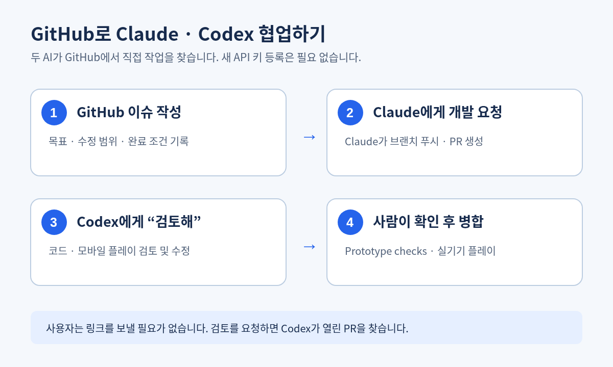

# GitHub로 Claude·Codex 협업하기

Claude Code와 이 Codex 환경은 같은 `mijiye29-creator/winter-rush` 저장소를 볼 수 있다. **사용자가 작업 링크를 옮길 필요는 없다.** Claude에게 작업을 맡기고 이 대화에서 “검토해”라고 하면, Codex가 GitHub의 최신 열린 PR을 찾아 확인한다. 작업 대상이 여러 개면 이슈·PR 번호로 구분한다.

| 단계 | 담당 | GitHub 기록 |
| --- | --- | --- |
| 작업 | Claude 또는 Codex | 이슈, 작업 브랜치, 커밋, PR |
| 검토·수정 | 다른 AI | PR 검토 의견과 후속 커밋 |
| 출시 결정 | 사용자 | CI·모바일 플레이 확인 후 병합 |

## 작업 방식

1. 사용자가 Claude에게 기능을 요청한다. Claude가 필요하면 이슈를 만들고 `origin/main` 기준 브랜치에서 구현해 PR을 올린다.
2. 사용자가 여기서 “검토해”라고 하면 Codex가 열린 PR을 직접 조회한다. 링크를 붙여 넣을 필요가 없다. Codex는 필요한 수정을 같은 PR에 반영하고 검사 결과를 기록한다.
3. Claude가 다시 수정할 때는 GitHub PR의 검토 의견을 읽는다. 두 AI는 서로의 채팅을 볼 수 없으므로 결정과 인수인계는 이슈·PR에 남긴다.
4. [Prototype checks](https://github.com/mijiye29-creator/winter-rush/actions)와 휴대폰 플레이를 확인한 뒤 사용자가 병합한다.

이 방식은 GitHub Actions용 AI API 키 등록이 필요 없다. GitHub 라벨만 붙여도 AI가 저절로 작업을 시작하지는 않는다. `@codex review` GitHub 댓글 기능은 Codex 저장소 환경이 연결되어 있을 때만 동작한다. PR #30에서는 환경을 만들라는 안내 댓글이 달렸으므로, 현재 검토는 이 Codex 대화에서 진행한다.
