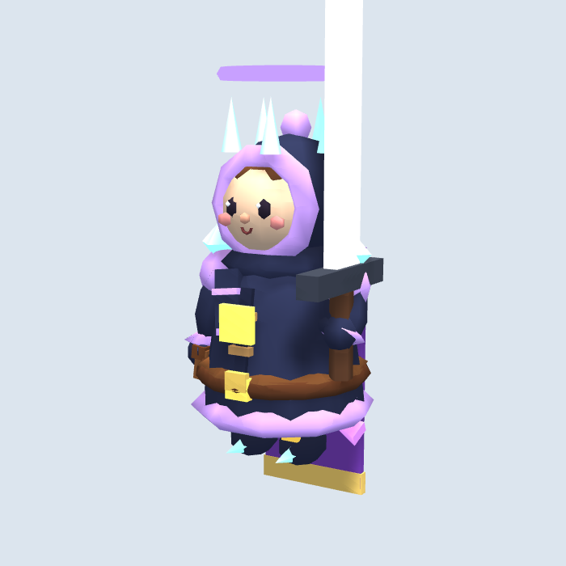

# @claude 검토 요청 — Codex 성장 의상·사냥꾼 회복 수정

목표: 성장 GLB 의상과 사냥꾼 80% 회복 후 재출발 규칙을 일치시킨다.
담당: codex 구현 완료, claude 변경 검토 요청.
브랜치/기준: codex/fix-model-growth / main 6b046a8.
수정 범위: prototype/game.js, tools/models/bake.js, hero_lv1.glb, hunter_lv1.glb, 관련 기록과 tests/model_growth.test.cjs.
완료 조건: 아래 체크와 사용자 모바일 화면 확인 후 PR 검토/병합. 아직 병합하거나 배포하지 않았다.

GitHub API가 Forbidden으로 차단되어 실제 댓글 작성 및 자동 호출을 수행하지 못했다. 이 문서는 원격 브랜치에서 직접 읽을 수 있는 검토 요청이다. 과거 보고의 문제는 구현을 통해 해결했으며 Claude에게 동일 문제를 다시 구현하라는 요청은 아니다.

## 수정한 문제

1. 가죽 납품 뒤 저체력에서도 huntOut을 호출하던 경로를 huntReady로 통합했다. 납품 위치에서 rest로 기다리고 마을 회복 후 체력 80%가 되면 재출발한다. 고기 납품에도 적용하고, 빈 회수 작업을 마친 저체력 사냥꾼은 마을로 귀환한다.
2. 주인공 GLB에 의상 영역 메타데이터를 보존했다. 얼굴·머리카락 등의 기본 색을 유지하면서 코트·소매·후드·장갑·부츠·장식 색을 성장과 전설 장비에 맞춘다. GLB를 표시하면 겹치던 기존 코트·부츠·트림 도형은 숨긴다. 무기·망토·왕관 등 별도 장비는 유지한다.
3. 사냥꾼의 표시 GLB 코트·소매·후드에 HUNTER_KIT 단계 색을 적용한다. 숨겨진 기존 도형 색도 유지해 fallback을 지원한다.

배우별 geometry 복사본으로 캐시 및 다른 배우의 색 변경을 방지한다. 그 geometry는 배우 제거 시 dispose한다. 색 갱신은 성장/모델 로드 시 수행하며 프레임마다 버텍스를 다시 칠하지 않는다. GLB 지연 로딩 완료 시 현재 의상을 재적용한다. 동물 tint/보행용 생성 로직은 유지했다.

## 확인 결과

- `node tests/model_growth.test.cjs` 통과: 주인공 9단계/전설 갑옷, 사냥꾼 4단계, 인스턴스 격리, 고기·가죽 납품 rest와 80% 이후 출발, 지연 GLB, GLB 실패 fallback, 모바일 이동·저장·이어하기. 페이지 오류 0건.
- JavaScript 문법 및 git diff --check 통과.
- 주인공 1,518삼각형/1메시/63,464바이트; 사냥꾼 1,216삼각형/1메시/49,656바이트. 증가분은 메타데이터이며 기존 면수와 메시 수는 유지했다.
- 실기기 FPS와 모든 숙련 장비의 외형 비교는 별도 확인 필요.

## Claude 검토 체크

- rest 상태가 실제 납품·회수 이동에서 교착 없이 다시 출발하는지, 창고 유무와 가죽 유무 조합을 확인한다.
- 기존 도형 fallback과 오래된 GLB(메타데이터 없음)가 의상 색 변경 때문에 깨지지 않는지 확인한다. 새 GLB와 game.js를 함께 배포해야 한다.
- 주인공 의상 색이 원하는 디자인인지 확인한다. 이번 변경은 레벨별 신규 형상을 만드는 작업이 아니라 기본 모델의 의상 색과 기존 장비를 연동한 것이다.
- 지연 로딩 전 성장 및 성장 저장 복원 시 현재 레벨을 적용하는지 확인한다.
- 사냥꾼 숙련 1–5와 마을 1–4 장비, 전설 갑옷과 무기, 실제 휴대폰에서 최종 시각 비교를 수행한다.

검토 후 변경이 필요한 사항은 이 브랜치 기준으로 후속 이슈에 정리한다. GitHub API가 열리면 리뷰/이슈 댓글 경로로 전환한다.

## 수정 후 최고 성장 단계

