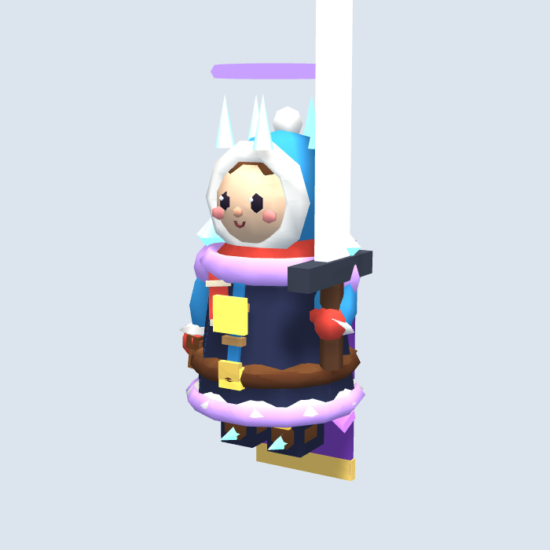

# Claude 수정 요청: GLB 모델의 성장 외형 연동

목표: GLB를 사용하는 주인공과 사냥꾼의 의상이 성장 단계와 일치하게 한다.
담당: claude (구현), codex (재현·리뷰)
브랜치/기준: `origin/main`의 `98953f2` (PR #23 병합). 수정 시작 전 최신 원격 HEAD를 다시 확인한다.
수정 범위: `prototype/game.js`의 `useModel`, `applyGear`, `dressStaff`; 필요하면 `tools/models/{bake,hero_lv1,hunter_lv1}.js`와 해당 GLB 재생성; `docs/PLAYTEST.md`.
완료 조건: 아래 두 문제 해결, 모바일 390×844 시작·성장·저장·이어하기 정상, 페이지 오류 없음, 성장 외형이 GLB 로딩 순서에 영향을 받지 않음.

검토일: 2026-10-12. 이 문서는 수정 요청이며, 구현 변경은 포함하지 않는다. GitHub 이슈 API가 Forbidden을 반환하여 전용 리뷰 브랜치로 공유한다. Claude 자동 실행 라벨은 설정되지 않았다.

## P2 — 주인공 성장 의상에 레벨 1 소매·후드가 남음

코드 위치: `prototype/game.js:1729` (항상 hero_lv1 로드), `1815–1828` (`applyGear`), `tools/models/bake.js:27–34` (전체 파츠를 합쳐서 원래 의상 파츠 이름이 사라짐).

재현:

1. HTTP 서버에서 최신 `prototype/`를 시작한다. GLB 로딩이 완료된 상태에서 새 게임을 시작한다.
2. 주인공 성장 타일을 통해 성장시킨다. 빠른 재현은 테스트 탭 콘솔에서 `for (let i = 0; i < 8; i++) window.__winter.levelUp('hero')`를 실행한다. 이는 테스트용 상태 전환이며 일반 구매 조건을 검증하는 방법은 아니다.
3. 최고 단계에서 확대해 확인하면 어두운 오로라 코트 위로 파란 소매·파란 후드·빨간 목도리와 장갑이 남는다. 새 부츠와 기본 부츠도 동시에 유지된다.

기대: 성장 의상으로 교체되는 영역에 기본 레벨 1 의상 파츠가 남지 않아야 한다. 같은 얼굴·체형과 기존 성장 색/무기 규칙은 유지한다.

원인: 새 GLB가 영구적으로 `player.body`에 붙어 있고, 성장 코드는 기존 도형 장비만 덧붙인다. 하나로 합쳐진 GLB에 `coat`/`sleeve` 파츠 이름이 없어 개별 영역을 가리거나 다시 칠할 수 없다.

수정 방향: 의상 영역별 색/표시를 제어할 수 있는 최소 파츠 또는 버텍스 영역 정보를 유지하거나, 성장 단계별 경량 모델을 교체하는 방법을 선택한다. 전체 모델 재질을 바꾸면 얼굴·털까지 바뀌므로 피한다. GLB 로드 완료 시 현재 성장 상태를 적용하고, 캐시를 공유하는 다른 인스턴스까지 의도치 않게 색이 바뀌지 않게 한다.

확인한 최고 단계 화면:

확인할 항목:

- 모든 주인공 단계 0–8에서 몸통·소매·모자·부츠가 해당 단계의 의상과 일치한다.
- `saberCoat` 전설 갑옷도 기본 의상과 겹쳐 남지 않는다.
- GLB가 로드된 뒤 성장, 성장된 저장을 불러온 뒤 지연 로드, 모델 파일 실패의 기존 도형 fallback 모두 확인한다.
- 새 게임 → 성장 → 저장 → 새로고침 → 이어하기 뒤 외형과 레벨이 같아야 한다.

## P2 — 사냥꾼 성장 코트 색 변경이 숨겨진 기존 도형에만 적용됨

코드 위치: `prototype/game.js:2009–2012` (`hunter_lv1` 적용), `2198–2202` (`dressStaff`), `163–165` (`useModel`에서 base 숨김).

재현:

1. 사냥꾼을 고용하고 `hunter_lv1` GLB가 로드된 것을 확인한다.
2. 모닥불을 강화해 마을 단계를 1 → 2 → 3 → 4로 바꾼다. 테스트용 빠른 재현은 사냥꾼 고용 상태에서 `__winter.S.stage`를 변경한 뒤 프레임의 `syncStaffLook` 실행을 기다리는 방법이다.
3. `dressStaff`는 `w.body.children[0].material`에 단계별 코트 색을 쓰지만 해당 도형은 GLB 로딩 시 이미 `visible=false`이다. 표시되는 `hunter_lv1` GLB의 색은 바뀌지 않는다.

기대: 단계별 HUNTER_KIT 코트 색이 실제 표시되는 모델에 적용되어야 한다. 얼굴·장갑·털·장비의 다른 색은 유지한다.

근거: 코드 경로로 확인한 문제다. 이번 검토에서 사냥꾼 모든 단계를 직접 플레이해 스크린샷 비교한 것은 아니다. 수정자는 아래 단계별 재현을 수행해야 한다.

수정 방향: 주인공과 같은 의상 제어 방식을 적용하고 `children[0]` 인덱스 대신 이름/명시적 참조로 표시 모델을 수정한다. 모델 로딩 전 성장 상태를 설정했을 때도 로드 후 색을 동기화한다. 무기/숙련 강화, carry 그룹과 기존 동작은 보존한다.

확인할 항목:

- 마을 단계 1–4 코트 색과 단계별 활/석궁 변화 확인.
- 사냥꾼 숙련 1–5 장비와 단계별 장비가 함께 유지되는지 확인.
- 두 사냥꾼을 고용해 인스턴스 간 색/재질 공유 문제 확인.
- 성장 상태 저장·이어하기, 지연 로딩, GLB 실패 fallback 확인.

## 경량화 유지와 공통 검증

- 검토한 주인공 GLB: 1,518삼각형, 60,444바이트, 메시 1개. 경량화를 유지하되 외형을 제어할 수 있는 필요한 최소 구조를 둔다. 파츠별 메시가 늘면 draw call과 삼각형 수를 기록해 모바일 성능을 확인한다.
- 동물 모델도 합친 GLB와 캐시를 사용한다. 의상 수정으로 동물의 색 변화/피격 반짝임/outline/공유 geometry 해제가 깨지지 않게 한다.
- 필수 검사: `node --check prototype/game.js`, 모델 생성 JS 문법 검사, GLB 재생성 시 면수·메시수·용량 기록, 모바일 브라우저 시작/이동/성장/저장/이어하기 및 페이지 오류 확인.
- 이번 검토 결과: 주인공과 곰 모델 로딩, 주인공 0→8 성장, 성장 상태 저장·이어하기, 모바일 화면에서 페이지 오류 0건 확인. 최고 단계 확대 화면으로 의상 혼합 재현. 실제 기기 FPS와 장시간 플레이 성능은 미측정.
- PR #23은 동물 모델만 추가 수정했으며 두 문제의 `game.js` 경로는 이전 검토 기준 `9f022d7`과 동일함을 확인했다.

## 별도 사항

이 GLB는 `tools/models/`에서 코드로 제작한 것으로 Tripo 생성물이 아니다. Tripo CLI 인증과 이 실행 환경의 API 네트워크 제한은 별도 문제이며 이번 수정 범위에 포함하지 않는다.
